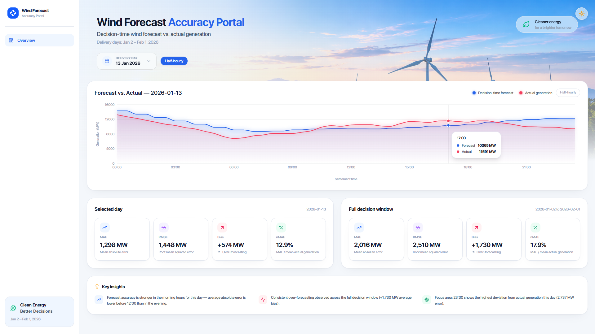
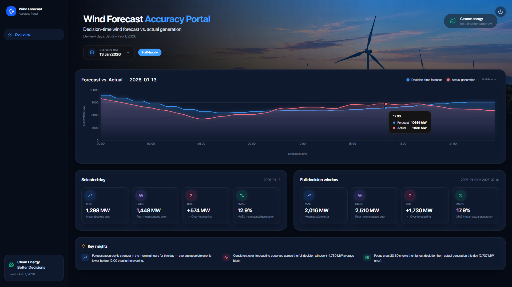

# Wind Forecast Accuracy Portal

A web app for a UK energy utility's day-ahead power-buying team. It answers two questions for each delivery day:

1. What was the **latest wind generation forecast actually available** at decision time (11:00 UK time on the day before delivery), for every half-hourly settlement period?
2. **How accurate** did that decision-time forecast turn out to be against actual metered wind generation (MAE, RMSE, bias, nMAE, MAPE)?

Scope: national-level wind only, Elexon BMRS only (`FUELHH` for actuals, `WINDFOR` for forecasts), covering purchase decisions made in January 2026 (delivery days **Jan 2, 2026 – Feb 1, 2026**).

- **Live app:** https://aokoremg.vercel.app/
- **Live API:** https://aokoremg.onrender.com (e.g. `GET /api/health`, `GET /api/days`)

> **Note on the Render free tier:** the backend spins down after inactivity, so the first request after idle can take up to ~50 seconds to wake up. The frontend shows an explicit "waking up the cloud server" message while this happens — it's expected, not a bug.

| Light mode | Dark mode |
|---|---|
|  |  |

---

## 1. Directory layout

```
.
├── backend/                       FastAPI service
│   ├── app/
│   │   ├── main.py                 FastAPI app, CORS, startup
│   │   ├── config.py               Env-driven settings (Elexon URL, decision cutoff, delivery window, DB path)
│   │   ├── elexon/
│   │   │   ├── client.py            HTTP client for the FUELHH & WINDFOR /stream endpoints
│   │   │   └── schemas.py           Pydantic models for raw Elexon responses
│   │   ├── ingestion/
│   │   │   └── ingest.py            Fetches & upserts actuals + all forecast revisions into SQLite (idempotent)
│   │   ├── domain/
│   │   │   ├── decision_forecast.py "As-of" latest-forecast-before-cutoff selection logic
│   │   │   ├── series.py            Builds the half-hourly forecast/actual/error series for one day
│   │   │   └── metrics.py           MAE / RMSE / bias / nMAE / MAPE calculations
│   │   ├── db/
│   │   │   ├── models.py            SQLAlchemy models: ActualGeneration, ForecastGeneration
│   │   │   └── session.py           Engine, session, init_db()
│   │   ├── api/
│   │   │   ├── routes_days.py       GET /api/days
│   │   │   ├── routes_series.py     GET /api/days/{date}/series
│   │   │   └── routes_metrics.py    GET /api/metrics
│   │   └── tests/                   Pytest suite (ingestion sanity, decision logic, metrics, API endpoints)
│   ├── Dockerfile                   python:3.12-slim, installs deps, runs ingestion on first boot, serves uvicorn
│   ├── docker-entrypoint.sh          Skips ingestion if the SQLite file already has data (idempotent restarts)
│   └── requirements.txt
│
├── frontend/                      React (Vite + TypeScript + Tailwind) single-page dashboard
│   ├── src/
│   │   ├── api/client.ts            Typed fetch wrappers for the three backend endpoints
│   │   ├── components/
│   │   │   ├── DayPicker.tsx          Delivery-day selector (Jan 2 – Feb 1, 2026, as returned by /api/days)
│   │   │   ├── ForecastActualChart.tsx Half-hourly forecast-vs-actual line chart (Recharts)
│   │   │   ├── MetricsSummary.tsx     MAE / RMSE / bias / nMAE stat tiles (per-day and full-window)
│   │   │   ├── LoadingScreen.tsx      Cold-start-aware loading gate for the Render free tier
│   │   │   └── Hero*, Sidebar, KeyInsights, ThemeToggle — supporting UI/visual components
│   │   └── pages/Dashboard.tsx       Wires day picker + chart + metrics together
│   ├── Dockerfile                    Two-stage build: Vite build, then serve static dist/
│   └── docker-entrypoint.sh           Injects the runtime API base URL (handles Docker/Codespaces/Vercel)
│
├── docker-compose.yml              Brings up backend + frontend together, with a persistent SQLite volume
├── .env.example                    Backend env vars (Elexon URL, decision cutoff, delivery window, DB path)
├── CLAUDE.md                       Full build log: domain decisions, phase-by-phase implementation notes
└── instructions.md                 Original assignment brief from the product manager
```

## 2. Core domain logic (why the numbers are what they are)

- **Decision-time cutoff:** 11:00 UK time on day `D-1` is treated as the day-ahead gate closure. For each settlement period on delivery day `D`, the app picks the `WINDFOR` record with that `startTime` whose `publishTime` is the most recent one `<= 11:00 UK` on `D-1` — never a later revision, even if one exists.
- **Hourly forecast vs. half-hourly actuals:** `WINDFOR` only publishes on-the-hour values, while `FUELHH` actuals are half-hourly. Each `:30` settlement period's decision-time forecast is forward-filled from the preceding `:00` period's value; this is called out explicitly in the API response rather than silently interpolated.
- **Metrics:** for each in-scope delivery day and settlement period, `error = decision_time_forecast - actual`. MAE, RMSE, and bias (mean signed error) are reported directly; nMAE (`MAE / mean(actual)`) is the headline normalized metric, with MAPE shown only as a secondary figure since it's unstable near zero generation.

See `CLAUDE.md` for the full phase-by-phase build log, including the data-shape findings and alternatives considered.

## 3. Running locally

### Option A — Docker Compose (recommended)

```bash
docker-compose up
```

This builds and starts both services. On first run against a fresh volume, the backend automatically runs ingestion against the live Elexon API before serving — this can take a minute or two. Subsequent restarts skip ingestion and start immediately.

- Backend: http://localhost:8000
- Frontend: http://localhost:4173

### Option B — Run services directly

**Backend:**
```bash
cd backend
python -m venv .venv && source .venv/bin/activate   # or .venv\Scripts\activate on Windows
pip install -r requirements.txt
cp ../.env.example ../.env   # adjust if needed
python -m app.ingestion.ingest   # one-time: fetch & store Elexon data
uvicorn app.main:app --reload --port 8000
```

**Frontend:**
```bash
cd frontend
npm install
cp .env.example .env   # set VITE_API_BASE_URL=http://localhost:8000
npm run dev
```

Frontend dev server runs on http://localhost:5173.

### Running tests

```bash
cd backend
pytest
```

The test suite runs against the already-ingested SQLite data (no mocking), so run ingestion first if the DB is empty.

## 4. API endpoints

| Endpoint | Description |
|---|---|
| `GET /api/health` | Liveness check |
| `GET /api/days` | In-scope delivery days (Jan 2 – Feb 1, 2026) with data-availability flags |
| `GET /api/days/{date}/series` | Half-hourly forecast/actual/error for one delivery day |
| `GET /api/metrics?from=&to=` | Aggregated MAE/RMSE/bias/nMAE/MAPE over a date range (default: full window) |

## 5. Deployment

- **Frontend** is deployed to **Vercel** as a static Vite build: https://aokoremg.vercel.app/
- **Backend** is deployed to **Render** (free tier) as a Docker web service, with ingestion run automatically against the live Elexon API on first boot: https://aokoremg.onrender.com

## 6. AI tool usage

This project was built with assistance from **Claude Code** (Anthropic), used throughout for scaffolding, implementation, debugging, and documentation across all phases (backend, frontend, ingestion, Docker, deployment). The full decision trail — including domain-logic choices, data-shape findings, and deviations from the original plan — is recorded phase-by-phase in `CLAUDE.md`.
